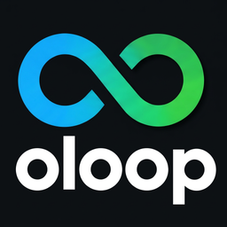

<p align="center">
  
</p>

Desktop client for [oloop](https://github.com/greebo72/oloop-spec), a local cross-project tracker for todos, questions, decisions, features and bugs. It reads and writes the same Markdown files with YAML frontmatter as the [oloop CLI](https://github.com/greebo72/oloop-cli) and the [Android client](https://github.com/greebo72/oloop-android).

<br clear="all">

## Why this exists

oloop keeps your open points — todos, questions, decisions, features, bugs — as plain Markdown files in one data folder, one folder per project. The CLI works at the desk, the phone app works everywhere else. This app is the third one: a desktop client for the screen you work at all day.

The hard part of several writers on one folder is not the transport, it is the format. So the format is the contract: `Core/` is a plain C# library that parses, validates and writes exactly what the spec defines, refuses what it does not understand, and never touches a file it cannot read. The UI is a thin layer on top of it.

No account, no server, no network access. The data folder is usually a synced folder (Syncthing, cloud drive, …), and that is the whole sync story.

Status: the app runs on macOS, Windows and Linux. The format module is tested against the conformance fixtures of the spec and against the installed Python CLI (a format drift check).

## Layout

| Path | Content |
|---|---|
| `Core/` | The format module: models, YAML frontmatter, the store (read, write, backup, conflict), filters, grouping. No Avalonia dependency |
| `ViewModels/` | MVVM view models (`CommunityToolkit.Mvvm`). `MainViewModel` is the shell and owns the write path; the dialogs only collect input |
| `Views/` | Avalonia XAML. The `Views` know the `Window`, the `ViewModels` do not |
| `Controls/` | Markdown renderer (Markdig), code block with copy button, resource converters |
| `Themes/` | Material 3 dark theme and the style classes |
| `OloopApp.Tests/` | xUnit tests, including a headless Avalonia UI suite that renders real pixels |
| `spec/` | The [oloop-spec](https://github.com/greebo72/oloop-spec) repo as a Git submodule. Its schemas and conformance fixtures are the contract |

## What the app does

- **Settings:** the data folder is picked once and remembered, together with the actor name that is written into `createdBy` and `updatedBy`. The folder and the actor also come from `OLOOP_ROOT` and `OLOOP_ACTOR`.
- **Project list:** one card per project with the number of open tasks and the most recent `updatedAt`.
- **Task list:** the project name in the header, a grouping control (none, created, modified, type, status), a "silent since" filter and a switch for closed tasks. Every row shows title, type, labels and the age since `updatedAt`.
- **Task detail:** type, title, status, labels, the description as rendered Markdown, comments, timestamps with their author, and the image of the task. Edit, close, reopen and comment from there.
- **New task and new project**, a search over titles and labels, and keyboard shortcuts (Ctrl+F, Ctrl+N, Ctrl+E, Ctrl+,, Escape, F5).
- **Files that cannot be read** are listed with the reason and are never written to.
- **Changes from elsewhere:** a file that changed on disk while you were editing it is a conflict, not a silent overwrite — you choose between reloading and overwriting.

## Design

Material 3 dark mode, generated from the seed `#4C5C92`. The type containers have to mean what the spec says (todo = primary container, feature = tertiary container), so the scheme is fixed instead of dynamic. Hierarchy comes from size and color, not from bold weight; a 4 dp spacing grid; one filled primary element per screen at most.

## Installation

The app is a single self-contained program. There is no installer: unpack the archive for your platform and start it. No .NET runtime is needed on the machine.

Download the archive from the [releases page](https://github.com/greebo72/oloop-desktop/releases). Every release has the three packages below.

| Platform | Archive |
|---|---|
| macOS (Apple silicon) | `oloop-<version>-macos-arm64.zip` |
| Windows (x64) | `oloop-<version>-win-x64.zip` |
| Linux (x64) | `oloop-<version>-linux-x64.tar.gz` |

**macOS.** Unpack the zip `oloop.app` into you Application folder and remove the quarantine mark from the terminal:

  ```
  xattr -dr com.apple.quarantine /Applications/oloop.app
  ```

**Windows.** Unpack the zip into any folder and run `oloop.exe`. The app is portable — the folder can live on a USB stick.

**Linux.** Unpack the tarball and run the binary in it:

```
tar -xzf oloop-<version>-linux-x64.tar.gz
cd oloop-<version>-linux-x64
./oloop
```

### First start

The app asks for two things before it can work, both in the settings dialog (Ctrl+,):

- **The data folder.** The folder with one subfolder per project. Everything oloop knows lives there, and it is usually a synced folder (Syncthing, cloud drive). It can also come from the `OLOOP_ROOT` environment variable.
- **Your name.** It is written into `createdBy` and `updatedBy` of every task you create or change. It can also come from `OLOOP_ACTOR`.

The settings are remembered in `settings.json` — in `%APPDATA%\oloop\` on Windows, in `~/.config/oloop/` everywhere else.

## Build and test

You need the .NET SDK. The project targets `net10.0`.

```
git clone --recurse-submodules https://github.com/greebo72/oloop-desktop.git
cd oloop-desktop
dotnet build
cd OloopApp.Tests && dotnet test
```

The format drift check against the reference Python CLI needs the `oloop` command on the `PATH`; without it, those tests are skipped. Everything else runs without it.

To run the app:

```
dotnet run --project OloopApp
```

## Packages

All packages are self-contained: the user unpacks the archive and runs the app, without installing a runtime.

| Platform | Package | Script |
|---|---|---|
| macOS (arm64) | `oloop.app` (zipped) | `bash scripts/package-macos.sh` |

The macOS package is a single file. That is not only about the download size: a PE assembly cannot be signed by `codesign`, so its signature ends up in an extended attribute of the file, and `zip` does not keep extended attributes. A bundle with PE assemblies in it therefore has a broken signature after it was unpacked, and Gatekeeper refuses the app. A single file keeps only Mach-O binaries in the bundle, and their signatures live in the file itself.
| Windows (x64) | `oloop-<version>-win-x64.zip` | `pwsh scripts/package-windows.ps1` |
| Linux (x64) | `oloop-<version>-linux-x64.tar.gz` | `bash scripts/package-linux.sh` |

There is no installer on Windows and no AppImage on Linux: a portable archive runs everywhere, an AppImage needs a FUSE that many systems do not have. The macOS bundle is signed ad-hoc — a real signature needs an Apple developer account. The packaging script verifies the signature of the *unpacked* archive and fails the build if it is broken, because that is the state the user gets.

The version in the packages comes from `<Version>` in `OloopApp.csproj`. A GitHub release builds all three and attaches the archives to it.

## License

Apache License 2.0 — see [LICENSE](LICENSE).

The user interface uses the font family [Inter](https://github.com/rsms/inter), which is embedded in the application. Inter is licensed under the SIL Open Font License 1.1 and may be bundled with software under any other license. The copyright notice and the OFL travel with the release — see [THIRD-PARTY-NOTICES.md](THIRD-PARTY-NOTICES.md).
